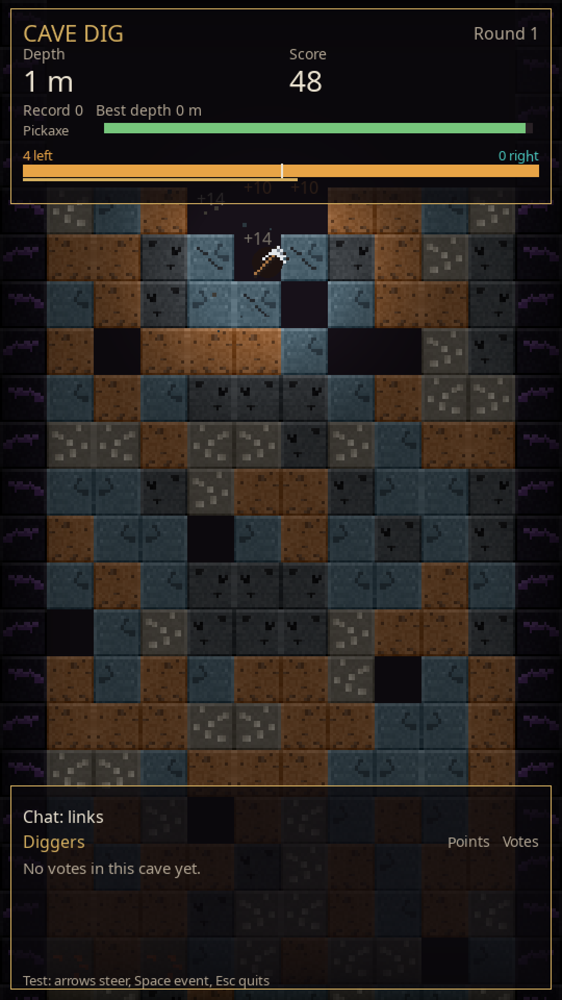
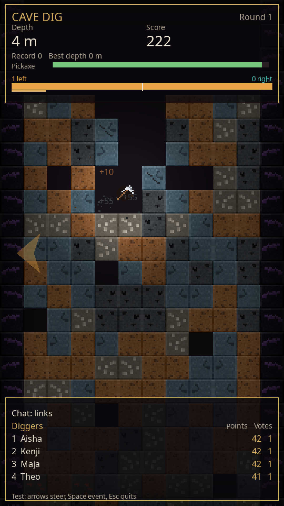
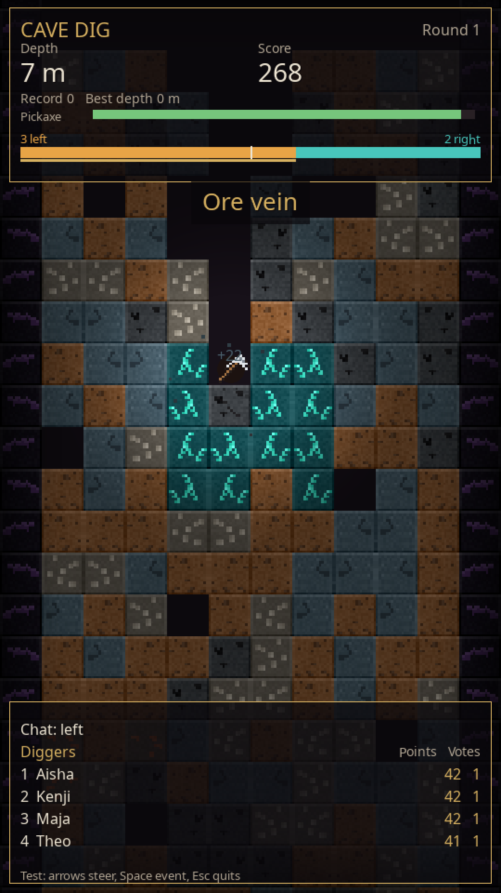

# Cave Dig

Die englische README ist [README.md](README.md). Die Bildschirmsprache ist standardmäßig Englisch (`language: en` in `config.yaml`). Deutsch fürs Fenster steht in `locales/de.yaml`. Diese Datei ist die deutsche Langfassung. Die kurze Liste für den Stream-Tag ist [ANLEITUNG.md](ANLEITUNG.md).

Ein kleines Höhlen-Spiel für einen **vertikalen YouTube-Dauerstream**. Eine Spitzhacke fällt durch ein Feld aus Blöcken, prallt ab und gräbt sich nach unten. Der Chat lenkt sie nach links oder rechts. Seltene Erze geben mehr Punkte. Die Höhle hört nicht auf. Wenn eine Runde endet, startet die nächste von allein.

Gedacht für ein Fenster, das OBS aufnimmt: innen 540×960, Fenster 1080×1920, also 9:16. Der Testmodus läuft **ohne** YouTube-Konto. Für den echten Chat trägst du später einen API-Schlüssel ein.

## Warum eigene Bilder

Die Grafik ist blockig, aber sie stammt nicht aus einem anderen Spiel. Name, Logo, Texturen, Schriften und Töne eines bekannten Klopper-Spiels gehören dessen Hersteller. Die darfst du nicht in ein eigenes Programm kopieren und als Stream-Overlay weiterverwenden. Darum liegen hier selbst gezeichnete 16×16-Bilder in `assets/textures/`. Die Stimmung darf an eine Höhle erinnern. Die Pixel sind neu.

## Sofort ausprobieren

Voraussetzung: Python 3.10 oder neuer. Unter Windows beim Installer „Add python.exe to PATH“ ankreuzen.

Windows:

```bat
start.bat
```

Linux und macOS:

```bash
chmod +x start.sh
./start.sh
```

Das Skript legt beim ersten Mal einen Ordner `.venv` an und installiert die Pakete aus `requirements.txt`. Danach öffnet sich das Fenster.

Ohne die Skripte geht auch:

```bash
pip install -r requirements.txt
python -m cave_dig
```

Im Testmodus schreiben Bots von allein Wörter wie `links`, `left` oder `左`. Du kannst mitsteuern:

| Taste | Wirkung |
| --- | --- |
| Pfeil links / A | Stimme links, halten schiebt zusätzlich |
| Pfeil rechts / D | Stimme rechts |
| Leertaste | Zufälliges Ereignis (mit Abklingzeit) |
| F12 | Bild nach `screenshots/` |
| Esc | Beenden und speichern |

Unten steht der Hinweis `Test: Pfeile lenken …`. Der Balken zeigt, wie viele Personen gerade links und rechts wollen. Alle 2,5 Sekunden gewinnt die Mehrheit und die Spitzhacke bekommt einen Schubs. Pro Fenster zählt jede Person nur einmal.

Rekord, beste Tiefe und die Gräber-Liste landen in `data/stand.json`. Das Log liegt in `logs/cave_dig.log`. Beides bleibt über Tage liegen, die Logdatei wird bei 2 MB abgeschnitten.

## Chat-Wörter

Zuschauer schreiben die Richtung in ihrer Sprache. Groß und klein ist egal, viele Akzente auch (`sağ` und `sag`, `LINKS` und `links`). Die Liste steht in [`languages.yaml`](languages.yaml). Ein Wort zählt nur als **ganzes Wort**. `brilliant` ist deshalb keine Stimme, `go left now` schon. Sehr kurze Kürzel (`l`, `r`, `li`, `re`) zählen nur, wenn die **ganze** Nachricht genau so lautet. `<` und `>` auch. Pfeile (`←`, `→`, `👈`) dürfen allein oder als eigenes Zeichen im Satz stehen.

Chinesisch und Japanisch: `左` zählt, `今日は左` nicht. Das Zeichen muss die ganze Nachricht sein oder zwischen Leerzeichen stehen.

Niederländisch ist schon abgedeckt, dort sagt man wie im Deutschen `links` / `rechts`. Eine neue Sprache ist ein Eintrag in der YAML-Datei, dann neu starten. Ein Test prüft, dass kein Wort auf zwei Richtungen zeigt:

```bash
pip install -r requirements-dev.txt
python -m pytest
```

Unten im Bild wechselt ein kurzer Hinweis: `Chat: links`, danach `left`, `gauche`, `左` und so weiter. Das sind Beispielwörter aus `languages.yaml`, nicht die Sprache der Anzeigen.

## Sprache im Fenster

Beschriftungen, Stimmenbalken, Gräber-Liste, Ereignis-Banner, Rundenende und die Statuszeile kommen aus [`locales/en.yaml`](locales/en.yaml) und [`locales/de.yaml`](locales/de.yaml).

```yaml
game:
  language: de   # Standard im Projekt ist en
```

Eine weitere Sprache: `locales/en.yaml` kopieren, zum Beispiel nach `locales/fr.yaml`, die Werte übersetzen, die Schlüssel und Platzhalter wie `{n}` lassen, dann `game.language: fr` setzen und neu starten. Fehlt die Datei, bleibt Englisch und das Log schreibt eine Warnung. `python -m pytest` prüft, dass jeder Schlüssel aus `en.yaml` auch in `de.yaml` steht.

Die Chat-Wörter (links, left, gauche, …) bleiben in `languages.yaml`. Die Befehle nach `!event` bleiben in `config.yaml`. Nur der Banner-Text liegt in der Sprachdatei unter `events.<id>`.

Drei Bilder aus einem Testlauf mit englischer Oberfläche (Seed 7, ohne YouTube). Zuerst leere Gräber-Liste, dann Punkte nach dem ersten Fenster, dann das Ereignis, auf Englisch „Ore vein“. Mit `language: de` stehen dort Tiefe, Punkte, Gräber und Erzader:







Befehle (Abklingzeit steht in `config.yaml`, Standard 40 Sekunden):

- `!event` würfelt ein Ereignis
- `!event einsturz`, `dunkelheit`, `sprengung`, `erzader`

`!eventuell` ist kein Befehl. Unbekannte Wörter nach `!event` werden ignoriert, das Spiel läuft weiter.

## YouTube-Chat anschließen

Es gibt zwei offizielle Wege über die **YouTube Data API v3**. Inoffizielle Leser ohne Schlüssel (zum Beispiel alte pytchat-Varianten) liegen nicht bei: die gehen kaputt, sobald YouTube die Website ändert, und ein Dauerstream soll nicht davon abhängen.

Lege eine Datei `.env` neben `config.yaml` an (Vorlage: `.env.example`). Die wird nicht ins Git übernommen.

### Kontingent, bevor du die Wartezeit verkleinerst

Das normale Tageslimit liegt bei **10.000 Einheiten** und setzt sich um Mitternacht pazifischer Zeit zurück.

| Aufruf | Kosten |
| --- | --- |
| `liveChatMessages.list` (neue Chatzeilen) | 5 |
| `videos.list` (Chat-ID zu einer Video-ID) | 1 |
| `liveBroadcasts.list` (eigener laufender Stream, nur mit OAuth) | 1 |

Ein Tag hat 86.400 Sekunden. Bei einem Abstand von 50 Sekunden sind das 1.728 Chat-Aufrufe, mal 5 = **8.640 Einheiten**. Dazu ein paar Aufrufe zum Finden des Chats. Das passt in ein 24/7-Limit. Die Rechnung steht auch im Log, sobald der Anbieter `youtube` ist.

Die API sagt selbst, wie schnell sie gefragt werden möchte (`pollingIntervalMillis`, oft wenige Sekunden). Cave Dig wartet **mindestens** diese Zeit und **mindestens** `min_poll_seconds` (Standard 50). Nachrichten kommen deshalb in Bündeln, ungefähr einmal pro Minute. Der Balken zählt das Bündel im nächsten Stimmen-Fenster. Für ein paar Stunden am Abend darfst du `min_poll_seconds` senken. Für einen ganzen Tag unter 45 Sekunden reicht das freie Limit nicht. Die aktuelle Tabelle: [Quota-Kosten der Data API](https://developers.google.com/youtube/v3/determine_quota_cost).

### Variante A: API-Schlüssel und Video-ID

1. Öffne die [Google Cloud Console](https://console.cloud.google.com/) und lege ein Projekt an, zum Beispiel `Cave Dig Stream`.
2. **APIs und Dienste → Bibliothek**. Suche **YouTube Data API v3** und aktiviere sie.
3. **APIs und Dienste → Anmeldedaten → Anmeldedaten erstellen → API-Schlüssel**.
4. Schränke den Schlüssel ein: Anwendung „Keine“, API-Einschränkung nur **YouTube Data API v3**.
5. Kopiere den Schlüssel in die `.env`:

   ```env
   YOUTUBE_API_KEY=dein_schluessel
   YOUTUBE_VIDEO_ID=die_id_aus_der_url
   ```

   Die ID ist der Teil nach `v=` in `https://www.youtube.com/watch?v=XXXXXXXXXXX`. Eine ganze URL darfst du auch einfügen, das Spiel schneidet die ID heraus. Bei `youtu.be/XXXXXXXXXXX` gilt dasselbe.
6. In `config.yaml`:

   ```yaml
   chat:
     provider: youtube
     youtube:
       mode: api_key
       min_poll_seconds: 50
   ```

7. Der Livestream muss **schon live** sein und der Live-Chat muss an sein. Vorher steht unten „No active live chat…“ (bei `language: de`: „Kein aktiver Live-Chat…“). Das Spiel wartet und versucht es wieder. Es beendet sich nicht.

Ein API-Schlüssel kann nicht fragen „welches Video läuft auf meinem Kanal gerade“. Dafür gibt es Variante B.

### Variante B: OAuth, eigener laufender Stream

1. Dieselben Schritte bis zur aktivierten YouTube Data API v3.
2. **APIs und Dienste → OAuth-Zustimmungsbildschirm**. Typ „Extern“, App-Name zum Beispiel Cave Dig, deine Gmail als Testnutzer eintragen. Bereich (Scope) später: nur lesen.
3. **Anmeldedaten → OAuth-Client-ID → Anwendungstyp Desktop**. Die JSON herunterladen und als `client_secret.json` in den Projektordner legen. Nicht committen. Eine leere Vorlage ist `client_secret.json.example`.
4. Einmal anmelden:

   ```bash
   python -m cave_dig.auth
   ```

   Der Browser geht auf. Du erlaubst **YouTube Readonly** (`youtube.readonly`). Danach liegt `tokens/youtube_token.json` auf der Platte. Auch geheim.
5. In `config.yaml`:

   ```yaml
   chat:
     provider: youtube
     youtube:
       mode: oauth
       min_poll_seconds: 50
   ```

Das Spiel ruft `liveBroadcasts.list` mit `mine=true` und `broadcastStatus=active` auf und nimmt die `liveChatId` von dort.

Neue Kanäle müssen Livestreams in YouTube Studio oft erst freischalten (Handy bestätigen, manchmal 24 Stunden warten). Wenn der Chat leer bleibt, liegt das dann an YouTube, nicht an einem Absturz. Die Zeile dazu steht im Log.

## OBS für einen vertikalen Dauerstream

1. In [YouTube Studio](https://studio.youtube.com/) unter **Livestream starten** einen Stream anlegen und den **Streamschlüssel** kopieren. Den Schlüssel nicht ins Git und nicht ins Bild legen.
2. OBS: **Einstellungen → Video**. Basis-Auflösung (Leinwand) **1080×1920**, Ausgabe dieselbe Auflösung, FPS **60**.
3. **Einstellungen → Stream**. Dienst YouTube, Streamschlüssel einfügen.
4. **Einstellungen → Ausgabe**. Encoder nach dem, was die Grafikkarte kann (NVENC, AMF, QuickSync oder x264). Für 1080×1920 bei 60 Bildern ungefähr 8.000–12.000 kbit/s Video, Audiobitrate 160, Keyframe-Intervall 2 Sekunden. Für 30 Bilder reichen oft 6.000–8.000 kbit/s, dann im Spiel `fps: 30` setzen, damit beides zusammenpasst.
5. Quelle **Fensteraufnahme**, Fenster „Cave Dig“. Cursor aufnehmen aus. Rechtsklick auf die Quelle → Transformieren → An Leinwand anpassen, falls ein Rand bleibt. Das Spielfenster ist schon 1080×1920.
6. **Einstellungen → Erweitert**: Verbindung automatisch wiederherstellen, Verzögerung ein paar Sekunden.
7. Am Rechner: Energiesparen so stellen, dass er nicht einschläft. Der Bildschirm darf ausgehen. OBS und das Spiel sind zwei Programme. Wenn OBS neu verbindet, gräbt die Spitzhacke weiter.
8. Stream starten. Den API-Weg aus dem vorigen Abschnitt erst einschalten, wenn der Chat in Studio wirklich offen ist.

YouTube erkennt ein 1080×1920-Bild als Hochformat. Der Streamschlüssel gehört in OBS, nicht in `config.yaml`.

## Einstellungen

Alles Sichtbare und alles Zeitliche steht in [`config.yaml`](config.yaml). Nach dem Speichern neu starten.

- `game`: Titel, Auflösungen, FPS, Spalten, Seed (`0` = jede Runde eine neue Höhle), `language` (`en` oder `de`)
- `vote`: Fensterlänge, Stärke des Schubs
- `physics`: Schwerkraft, Abprall
- `integrity`: wie schnell die Spitzhacke kaputtgeht. `passive_drain` beendet irgendwann auch eine ruhige Runde
- `blocks`: Treffer und Punkte
- `generation`: welche Blöcke in welcher Tiefe vorkommen
- `events`: Befehl, Abklingzeit, Zufall
- `chat.provider`: `simulator`, `youtube` oder `twitch`

Farben sind drei Zahlen Rot, Grün, Blau von 0 bis 255.

## Einen Block dazunehmen

1. Unter `blocks` einen Eintrag. `hits` ist die Zahl der Treffer, `points` die Grundpunkte. Tiefe multipliziert später etwas drauf, gedeckelt über `score` in der Config.
2. `pattern` ist eines von: `speckles`, `pebbles`, `cracks`, `ore`, `crystals`, `veins`, `charge`. Ein neues Muster ist eine Funktion in `cave_dig/textures.py` und eine Zeile in `_BUILDERS`, plus der Name in `cave_dig/blockdefs.py`.
3. Unter `generation.bands` dem Block ein Gewicht geben, sonst kommt er nie vor. `air` ist eine Lücke, `charge` ist der Sprengsatz (`explosive: true`), `bedrock` ist unkaputtbar.
4. Liegt `assets/textures/deinblock.png` (16×16), gewinnt die Datei. Fehlt sie, malt das Spiel eine und speichert sie. Du kannst die PNG in einem Malprogramm ändern.

## Ein Ereignis dazunehmen

Ereignisse sind kleine Klassen in `cave_dig/events/`. `on_start` läuft einmal, `on_update` jeden Frame, `light_scale` macht die Lampe kleiner (siehe `darkness.py`).

1. Datei kopieren, Klasse von `CaveEvent` ableiten.
2. In `cave_dig/events/__init__.py` in `EVENT_TYPES` eintragen.
3. In `config.yaml` unter `events.ids`, `events.durations` und `events.aliases` ergänzen.
4. Den Banner-Text `events.deine_id` in `locales/en.yaml` und `locales/de.yaml` eintragen, und denselben Schlüssel in `REQUIRED_KEYS` in `cave_dig/i18n.py`.

Wirf eine Ausnahme lieber nicht absichtlich: das Spiel fängt Fehler in `on_start` und `on_update` ab und schreibt sie ins Log, damit ein Experiment den Nacht-Stream nicht killt. Chat und Netz sind genauso abgefangen. Eine kaputte `config.yaml` stoppt dagegen schon beim Start, mit einer deutschen Meldung. Lieber gar nicht loslaufen als stundenlang falsch.

## Wo der Code liegt

| Datei | Aufgabe |
| --- | --- |
| `cave_dig/app.py` | Fenster und Schleife |
| `cave_dig/game.py` | Runde, ohne zu zeichnen |
| `cave_dig/world.py` | Gitter, wird nach oben hin vergessen, damit der Speicher nicht wächst |
| `cave_dig/physics.py` | Fall und Abprall |
| `cave_dig/languages.py` | Wörter aus `languages.yaml` |
| `cave_dig/i18n.py` | Texte im Fenster aus `locales/` |
| `cave_dig/votes.py` | Zeitfenster und Mehrheit |
| `cave_dig/scoring.py` | Punkte und `data/stand.json` |
| `cave_dig/events/` | Einsturz, Dunkelheit, Sprengung, Erzader |
| `cave_dig/chat/` | Simulator, YouTube, Twitch-Platzhalter |
| `cave_dig/render.py` | Alles, was du siehst |

`game.py` kennt kein Fenster. Darum können die Tests eine Runde rechnen, ohne SDL. Das ist derselbe Schnitt wie „Logik hier, Zeichnen dort“ in einem C++-Programm.

Twitch hat dieselbe Schnittstelle (`start`, `poll`, `stop`), verbindet aber noch nicht. Die Schritte für IRC stehen oben in `cave_dig/chat/twitch.py`.

## Tests

```bash
pip install -r requirements-dev.txt
python -m pytest
```

Ein Lauf ohne echtes Fenster, mit drei Bildern:

```bash
SDL_VIDEODRIVER=dummy python -m cave_dig --headless --demo --seed 7 --frames 250 --screenshot-dir screenshots --screenshot-frames 80,170,240
```

Unter Windows die Umgebungsvariable `SDL_VIDEODRIVER` nur setzen, wenn du wirklich kein Fenster willst.

## Was du noch einträgst

- **Test sofort:** nichts. `start.bat` oder `./start.sh` reicht.
- **Echter Chat:** API-Schlüssel oder OAuth, wie oben, und `chat.provider: youtube`.
- **Senden:** den Streamschlüssel nur in OBS, nicht in dieses Projekt.
- **Deutsche Anzeigen:** in `config.yaml` `language: de`.
