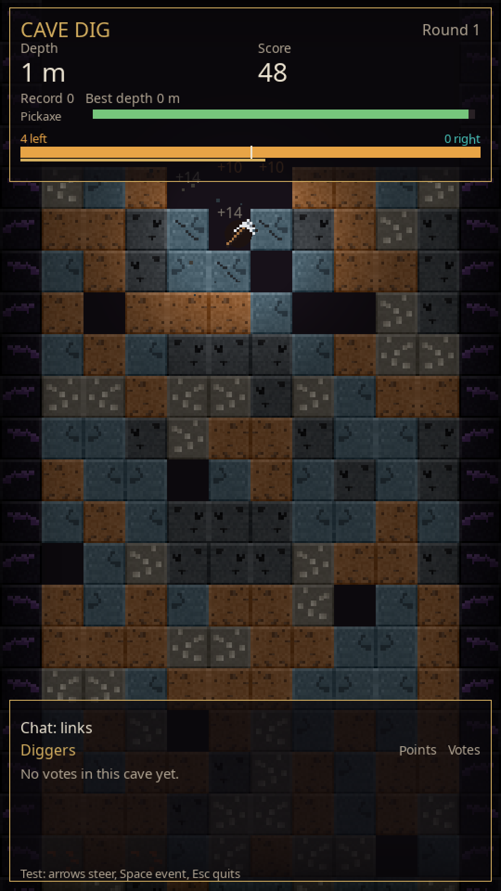
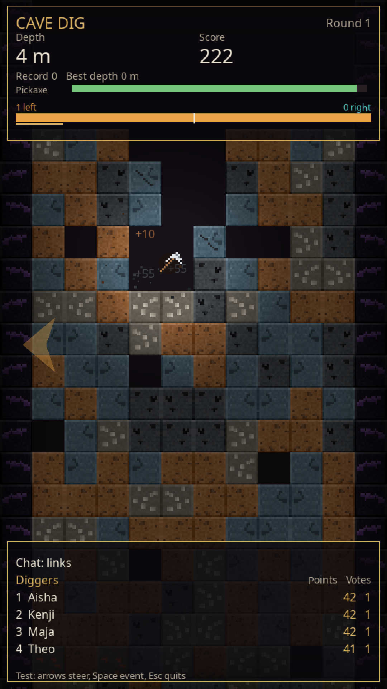
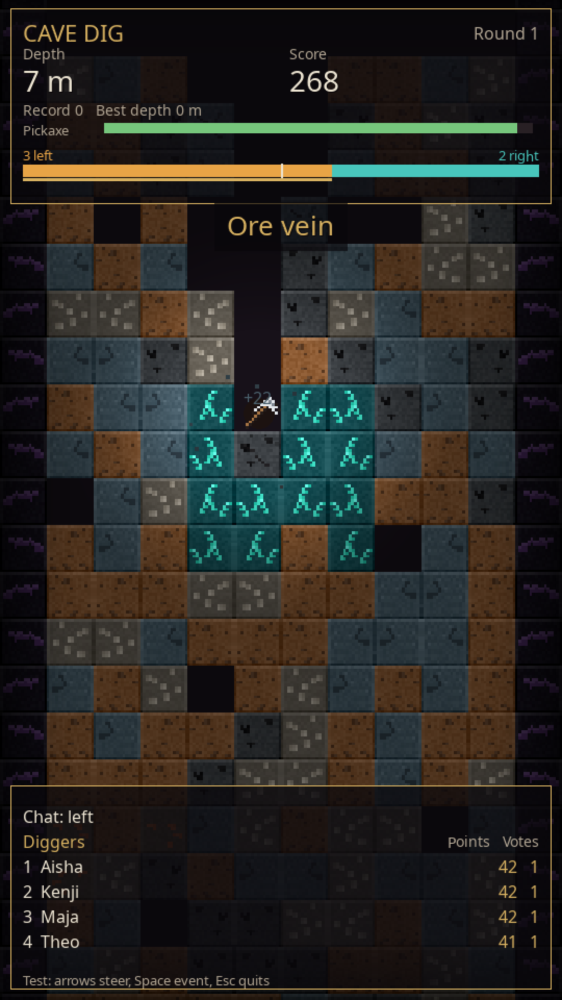

# Cave Dig

A small cave game for a **vertical YouTube livestream**. A pickaxe falls through a grid of blocks, bounces, and digs downward. Chat steers it left or right. Rarer ores score more. The cave does not end. When a round finishes, the next one starts on its own.

The window is meant for OBS: the game draws at 540×960 and shows a 1080×1920 window, so 9:16. Test mode runs **without** a YouTube account. For a real chat you add an API key later.

The screen language defaults to English (`language: en` in `config.yaml`). German is included. The German guide is [README.de.md](README.de.md) and the stream-day checklist is [ANLEITUNG.md](ANLEITUNG.md).

## Why the art is original

The look is blocky, and it is not taken from another game. The name, logo, textures, fonts, and sounds of a well-known block game belong to its maker. You may not copy them into your own program and stream them as an overlay. The 16×16 pictures in `assets/textures/` are drawn for this project. The mood can suggest a cave. The pixels are new.

## Try it now

You need Python 3.10 or newer. On Windows, tick “Add python.exe to PATH” in the installer.

Windows:

```bat
start.bat
```

Linux and macOS:

```bash
chmod +x start.sh
./start.sh
```

The script creates a `.venv` folder the first time and installs `requirements.txt`. Then the window opens.

Without the scripts:

```bash
pip install -r requirements.txt
python -m cave_dig
```

In test mode, bots type words such as `links`, `left`, or `左`. You can steer too:

| Key | Effect |
| --- | --- |
| Left arrow / A | Vote left; holding also pushes |
| Right arrow / D | Vote right |
| Space | Random event (with a cooldown) |
| F12 | Save a picture to `screenshots/` |
| Esc | Quit and save |

The line at the bottom says `Test: arrows steer …`. The bar shows how many people want left and how many want right. Every 2.5 seconds the majority wins and the pickaxe gets a nudge. Each person counts once per window.

High score, best depth, and the digger list are stored in `data/stand.json`. Test mode with bots uses its own file, `data/stand.simulator.json`, so bot names never reach the real list. The log is `logs/cave_dig.log`. Both survive for days. The log file rolls over at 2 MB.

## Chat words

Viewers type the direction in their own language. Case does not matter, and many accents do not either (`sağ` and `sag`, `LINKS` and `links`). The list is [`languages.yaml`](languages.yaml). A word counts only as a **whole word**. `brilliant` is not a vote. `go left now` is. Very short forms (`l`, `r`, `li`, `re`) count only when the **entire** message is exactly that. Same for `<` and `>`. Arrows (`←`, `→`, `👈`) may stand alone or as their own token in a sentence.

Chinese and Japanese: `左` counts. `今日は左` does not. The character must be the whole message, or a separate piece between spaces.

Dutch is already covered, because it uses the same words as German: `links` / `rechts`. A new chat language is one entry in the YAML file, then restart. A test checks that no word points at two directions:

```bash
pip install -r requirements-dev.txt
python -m pytest
```

A short hint rotates at the bottom: `Chat: links`, then `left`, `gauche`, `左`, and so on. Those words are examples, not the UI language.

## On-screen language

HUD labels, the vote bar, the leaderboard, event banners, round-end lines, the rotating hint prefix, and the status line come from [`locales/en.yaml`](locales/en.yaml) and [`locales/de.yaml`](locales/de.yaml). `config.yaml` sets the file:

```yaml
game:
  language: en   # or de
```

To add another language:

1. Copy `locales/en.yaml` to `locales/fr.yaml` (the filename is the code you will type).
2. Translate the values. Keep every key. Keep placeholders such as `{n}`, `{score}`, and `{hint}` exactly.
3. Set `game.language: fr` and restart.
4. `python -m pytest` checks that every key in `en.yaml` also exists in `de.yaml`, with the same placeholders. Compare a new file the same way if you want that guarantee.

A missing file or a broken YAML falls back to English and writes a warning to the log. The game keeps running. Chat direction words stay in `languages.yaml`. They are separate from these UI files. Event **commands** (`!event einsturz`) stay in `config.yaml`. The banner text for that event is `events.cave_in` in the locale file.

Three frames from a test run with the English UI (seed 7, no YouTube). First the digger list is empty, then points appear after the first vote window, then the ore-vein event:







Commands (cooldown is in `config.yaml`, default 40 seconds):

- `!event` rolls a random event
- `!event einsturz`, `dunkelheit`, `sprengung`, `erzader` (English aliases such as `cave_in` and `darkness` work too)

`!eventuell` is not a command. Unknown words after `!event` are ignored and the game keeps going.

## Connect YouTube chat

There are two official paths through the **YouTube Data API v3**. Unofficial readers that need no key (older pytchat-style libraries) are not included. They break when YouTube changes the website, and a stream that runs for days should not depend on that.

Create a `.env` file next to `config.yaml` (template: `.env.example`). It is not committed.

### Quota, before you shorten the wait

The usual daily quota is **10,000 units**. It resets at midnight Pacific Time.

| Call | Cost |
| --- | --- |
| `liveChatMessages.list` (new chat lines) | 5 |
| `videos.list` (chat id for a video id) | 1 |
| `liveBroadcasts.list` (your own live stream, OAuth only) | 1 |

A day has 86,400 seconds. A 50-second gap is 1,728 chat calls, times 5 = **8,640 units**, plus a few calls to find the chat. That fits a 24/7 quota. The same estimate is written to the log when the provider is `youtube`.

The API also says how soon it wants to be asked (`pollingIntervalMillis`, often a few seconds). Cave Dig waits **at least** that long and **at least** `min_poll_seconds` (default 50). Messages therefore arrive in bundles, about once a minute. The bar counts that bundle in the next vote window. For a few evening hours you may lower `min_poll_seconds`. For a full day, a gap under 45 seconds does not fit the free quota. Current table: [YouTube Data API quota costs](https://developers.google.com/youtube/v3/determine_quota_cost).

### Option A: API key and video id

1. Open the [Google Cloud Console](https://console.cloud.google.com/) and create a project, for example `Cave Dig Stream`.
2. **APIs & Services → Library**. Search for **YouTube Data API v3** and enable it.
3. **APIs & Services → Credentials → Create credentials → API key**.
4. Restrict the key: application “None”, API restriction only **YouTube Data API v3**.
5. Put the key in `.env`:

   ```env
   YOUTUBE_API_KEY=your_key
   YOUTUBE_VIDEO_ID=the_id_from_the_url
   ```

   The id is the part after `v=` in `https://www.youtube.com/watch?v=XXXXXXXXXXX`. A full URL is fine. The game cuts the id out. The same works for `youtu.be/XXXXXXXXXXX`.
6. In `config.yaml`:

   ```yaml
   chat:
     provider: youtube
     youtube:
       mode: api_key
       min_poll_seconds: 50
   ```

7. The livestream must **already be live** and live chat must be on. Until then the status line says “No active live chat…”. The game waits and retries. It does not quit.

An API key cannot ask “which video is live on my channel right now”. That is option B.

### Option B: OAuth, your own live broadcast

1. Same steps through enabling YouTube Data API v3.
2. **APIs & Services → OAuth consent screen**. Type “External”, app name for example Cave Dig, add your Gmail as a test user. Scope later: read only.
3. **Credentials → OAuth client ID → Desktop app**. Download the JSON and save it as `client_secret.json` in the project folder. Do not commit it. An empty template is `client_secret.json.example`.
4. Sign in once:

   ```bash
   python -m cave_dig.auth
   ```

   The browser opens. Allow **YouTube Readonly** (`youtube.readonly`). Then `tokens/youtube_token.json` is on disk. That file is secret too.
5. In `config.yaml`:

   ```yaml
   chat:
     provider: youtube
     youtube:
       mode: oauth
       min_poll_seconds: 50
   ```

The game calls `liveBroadcasts.list` with `mine=true` and `broadcastStatus=active` and takes `liveChatId` from there.

New channels often have to unlock livestreaming in YouTube Studio (phone check, sometimes a 24-hour wait). If chat stays empty, that is YouTube, not a crash. The log line says so.

## OBS for a vertical 24/7 stream

1. In [YouTube Studio](https://studio.youtube.com/), under **Go live**, create a stream and copy the **stream key**. Do not put that key in git or on screen.
2. OBS: **Settings → Video**. Base (canvas) resolution **1080×1920**, output the same, FPS **60**.
3. **Settings → Stream**. Service YouTube, paste the stream key.
4. **Settings → Output**. Encoder whatever the GPU offers (NVENC, AMF, QuickSync, or x264). For 1080×1920 at 60 fps, about 8,000–12,000 kbit/s video, audio 160, keyframe interval 2 seconds. At 30 fps, 6,000–8,000 kbit/s is often enough. Then set `fps: 30` in the game so the two match.
5. Source **Window Capture**, window “Cave Dig”. Do not capture the cursor. Right-click the source → Transform → Fit to screen if a border remains. The game window is already 1080×1920.
6. **Settings → Advanced**: reconnect automatically, a few seconds of delay.
7. On the computer: power settings so it does not sleep. The monitor may turn off. OBS and the game are two programs. If OBS reconnects, the pickaxe keeps digging.
8. Start the stream. Turn on the API path from the previous section only after chat is actually open in Studio.

YouTube treats a 1080×1920 frame as portrait. The stream key belongs in OBS, not in `config.yaml`.

## Settings

Everything you see and every timer lives in [`config.yaml`](config.yaml). Restart after saving.

- `game`: title, resolutions, FPS, columns, seed (`0` = a new cave every round), `language` (`en` or `de`)
- `vote`: window length, nudge strength
- `physics`: gravity, bounce
- `integrity`: how fast the pickaxe breaks. `passive_drain` ends even a quiet round eventually
- `blocks`: hits and points
- `generation`: which blocks appear at which depth
- `events`: command, cooldown, random rolls
- `chat.provider`: `simulator`, `youtube`, or `twitch`

Colors are three numbers, red, green, blue, from 0 to 255.

## Add a block

1. An entry under `blocks`. `hits` is how many hits it takes. `points` is the base score. Depth multiplies that a little, capped by `score` in the config.
2. `pattern` is one of: `speckles`, `pebbles`, `cracks`, `ore`, `crystals`, `veins`, `charge`. A new pattern is a function in `cave_dig/textures.py`, one line in `_BUILDERS`, and the name in `cave_dig/blockdefs.py`.
3. Give the block a weight under `generation.bands`, or it never appears. `air` is a gap, `charge` is the explosive (`explosive: true`), `bedrock` cannot be broken.
4. If `assets/textures/yourblock.png` exists (16×16), that file wins. If it is missing, the game paints one and saves it. You can edit the PNG in a paint program.

Block names in `config.yaml` are not drawn on screen.

## Add an event

Events are small classes in `cave_dig/events/`. `on_start` runs once, `on_update` every frame, `light_scale` shrinks the lamp (see `darkness.py`).

1. Copy a file and subclass `CaveEvent`.
2. Register it in `EVENT_TYPES` in `cave_dig/events/__init__.py`.
3. Add it under `events.ids`, `events.durations`, and `events.aliases` in `config.yaml`.
4. Add `events.your_id` to `locales/en.yaml` and `locales/de.yaml`, and to `REQUIRED_KEYS` in `cave_dig/i18n.py`. That is the banner text.

Do not raise on purpose: the game catches errors in `on_start` and `on_update` and writes them to the log, so an experiment does not kill an overnight stream. Chat and network errors are caught the same way. A broken `config.yaml` stops at startup instead, with a message. Better not to start than to run wrong for hours.

## Where the code lives

| File | Job |
| --- | --- |
| `cave_dig/app.py` | Window and loop |
| `cave_dig/game.py` | The round, without drawing |
| `cave_dig/world.py` | Grid; rows far above are forgotten so memory stays flat |
| `cave_dig/physics.py` | Falling and bouncing |
| `cave_dig/languages.py` | Words from `languages.yaml` |
| `cave_dig/i18n.py` | On-screen text from `locales/` |
| `cave_dig/votes.py` | Time window and majority |
| `cave_dig/scoring.py` | Points and `data/stand.json` |
| `cave_dig/events/` | Cave-in, darkness, blast, ore vein |
| `cave_dig/chat/` | Simulator, YouTube, Twitch stub |
| `cave_dig/render.py` | Everything you see |

`game.py` does not know about a window. That is why tests can run a round without SDL. Same split as “logic here, drawing there” in a C++ program.

Twitch has the same interface (`start`, `poll`, `stop`) and does not connect yet. The IRC steps are at the top of `cave_dig/chat/twitch.py`.

## Tests

```bash
pip install -r requirements-dev.txt
python -m pytest
```

A run with no real window, and three pictures:

```bash
SDL_VIDEODRIVER=dummy python -m cave_dig --headless --demo --seed 7 --frames 250 --screenshot-dir screenshots --screenshot-frames 80,170,240
```

On Windows, set `SDL_VIDEODRIVER` only when you truly want no window.

## What you still fill in

- **Try it now:** nothing. `start.bat` or `./start.sh` is enough.
- **Real chat:** an API key or OAuth, as above, and `chat.provider: youtube`.
- **Going live:** the stream key only in OBS, not in this project.
- **German labels:** `language: de` in `config.yaml`.

## How it was made

- Idea, requirements and testing: me
- Code: written by AI (Cursor first, then reviewed and improved by Claude Code)
